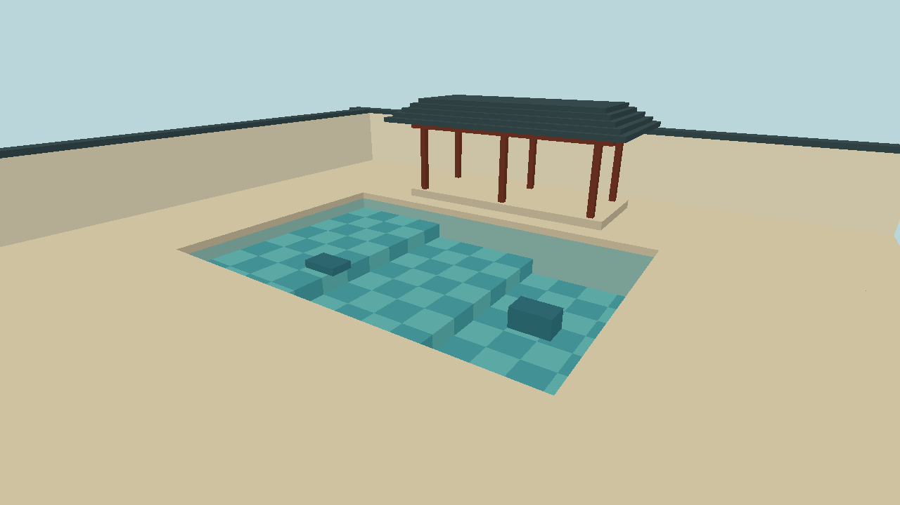

# 庭院水池的实时水面渲染

**Real-Time Water Rendering in a Courtyard Pool · CG 100433 课程项目**

在一个可漫游的庭院里，用同一片平静水面观察三种变化：抬低视角时墙体倒影的强弱、水下花砖随波纹产生的扭曲，以及池底从浅到深的颜色过渡。有限的池岸和容易辨认的几何物体也提供了检查倒影错位、采样越界和深度错误的参照。

**当前进度 · W1 静态场景。** C++ 和 OpenGL 原型已可运行。下图为默认机位的实际输出。水面暂用半透明平面标记平均高度 `y = 0`，下方的三级池底、棋盘砖和两块石体用于后续观察折射。GLSL 动态水面从 W2 开始。各阶段的目标见[六周执行计划](EXECUTION_PLAN.md)。



## 构建与运行

已验证环境为 Windows、MinGW-w64 GCC 15.2 和 CMake。需要 CMake 3.16 或更新版本、Git、C/C++ 编译器以及支持桌面 OpenGL 兼容模式的图形环境。CMake 优先使用已安装的 GLFW 3.3+，否则首次配置会联网下载 GLFW 3.4。场景几何和颜色均由代码生成。

在仓库根目录的 PowerShell 中执行，确保 MinGW 的 `bin` 目录位于 PATH。

```powershell
cmake -S . -B build -G "MinGW Makefiles" -DCMAKE_BUILD_TYPE=Release
cmake --build build --parallel
.\build\courtyard.exe
```

用 **W/S** 前后移动、**A/D** 横移、**方向键** 转动视角、**Q/E** 降低或升高机位。按 **R** 恢复截图中的机位，**Esc** 退出。要复现基准画面，运行 `.\build\courtyard.exe --capture build/w1.ppm`，程序使用同一渲染路径在隐藏窗口绘制一帧并退出。

## 场景与交互

- 一个庭院和一个水池。岸边布置墙或亭子以提供清晰倒影，水下放置石块或花纹砖，池底使用斜坡或台阶以呈现水深变化。
- 相机在水面上方移动。控制面板提供相机控制、波浪参数，以及反射、折射扰动和 Fresnel 混合的独立开关。
- 基线采用光栅化近似。完整流体模拟、破碎浪、精确焦散、水下相机和开放世界场景均在范围之外。基线稳定且时间充足时，岸边泡沫与局部交互涟漪中最多选做一项。

## 一帧水面如何生成

| 环节 | 实现要点 | 可观察结果 |
| --- | --- | --- |
| 波形和法线 | 先叠加多个低振幅定向正弦波做顶点位移，从波函数求法线，再在统一坐标空间合入动态法线贴图。时间允许时可改用 Gerstner 波。 | 大尺度起伏改变轮廓，小尺度扰动改变高光和纹理采样。 |
| 平面反射 | 将相机关于平均水面镜像，把庭院绘入反射纹理。裁剪水面另一侧的几何，并处理镜像视图的面剔除。 | 移动相机时建筑倒影仍与池岸对齐，波纹轻微扭曲倒影。 |
| 折射 | 从主相机单独绘制水下几何的颜色和深度，排除水面网格。按法线偏移投影采样坐标，限制偏移并检查深度或有效性，无效时回退至未扰动坐标。 | 花砖随波扭曲，池边与物体轮廓处不会采到岸上颜色。 |
| 水色与合成 | 在同一空间重建水面和水下场景位置，估算光在水中的传播距离，用可调颜色系数做指数衰减。最终场景 pass 按 Schlick 近似混合反射与衰减后的透射分量。 | 浅水较清，深水着色更强，掠射视角的倒影比俯视时更明显。 |

## 验收与交付

1. 在开发机上以 **1280 × 720、至少 30 FPS** 为目标。最终报告记录实际硬件、帧时间和测量结果，并分别检查反射、折射和最终场景 pass 的开销。
2. 固定同一机位，保留全效果画面，再分别关闭反射、折射扰动和 Fresnel 混合进行单项对照。关闭 Fresnel 时使用固定混合权重。
3. 提交源码、运行所需资产及署名、构建与运行说明，以及含截图和帧时间数据的短报告。最终演示应可按说明复现。

## 团队与资料

提案列出的成员为徐川、张开翔、韩赟晨、黄宇镐、李奕坤。个人职责待团队确认，全员参与集成评审和报告。

本文依据三页初步提案 `CG100433_Preliminary_Project_Proposal.pdf` 整理。仓库另附[课程提案模板](Proposal_template_for_CG100433_course_project.pdf)。

- Mark Finch，*Effective Water Simulation from Physical Models*，GPU Gems 第 1 章，2004。用于波形和法线设计。
- Tiago Sousa，*Generic Refraction Simulation*，GPU Gems 2 第 19 章，2005。用于折射纹理和扰动设计。
- Juan Guardado、Daniel Sánchez-Crespo，*Rendering Water Caustics*，GPU Gems 第 2 章，2004。焦散背景阅读。
