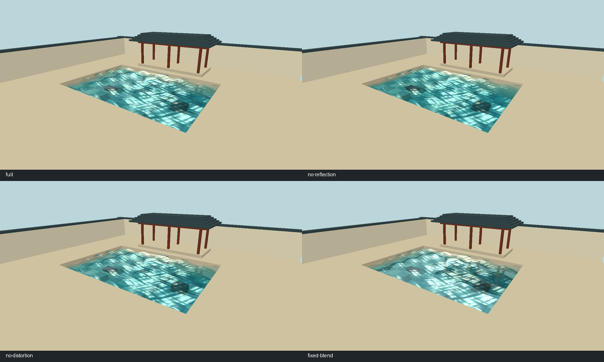
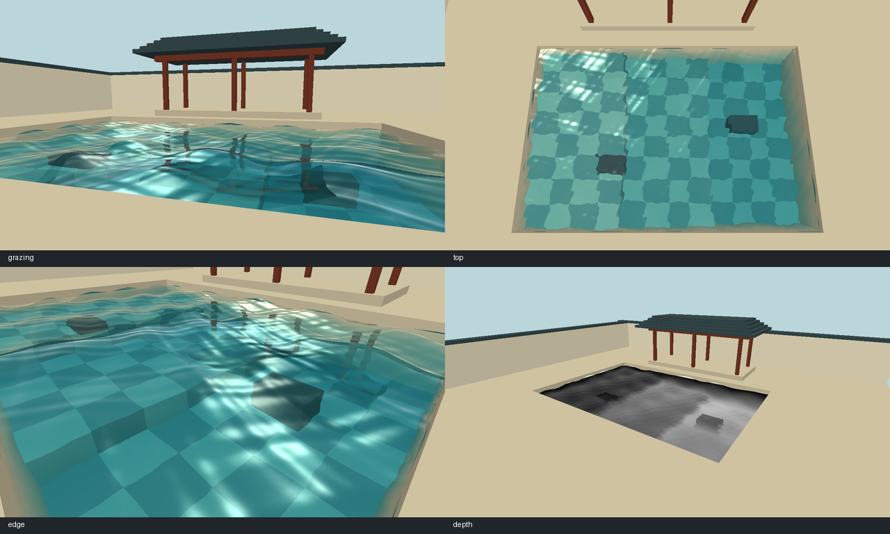

# 庭院水池实验报告与演示

本文记录初始原型。主题化场景的 1280 × 720 可见窗口实测、演示材料与来源见[最终报告](final/README.md)。

## 画面验收

固定默认机位、振幅倍率 1、动画时间 1 秒，各模式输出 1280 × 720 的 RGB 帧。与全效果图逐像素对照，关闭倒影改变 92,206 个像素，关闭折射扰动改变 66,239 个像素，改用固定混合权重改变 91,902 个像素。关闭扰动时保留了水下图像和吸收。比较图中每一格缩至 640 × 360，像素统计使用原帧。

掠射机位能辨认亭柱倒影，俯视机位能看清砖纹、台阶与浅深水色，近岸机位可检查石体轮廓和池壁。右下灰度图显示视线在水中的估计传播距离，较长的路径更亮，5 个场景单位以上显示白色。最初水下通道缺少池壁，池岸附近会采到清屏深度。加入沿平均水面裁剪的池壁后，原先的亮白边带消失。着色器还会在扰动越界、深度无效或跨越深度突变时回退至原坐标。

## 性能记录

测试机为 Intel Core Ultra 5 125H，OpenGL 渲染器报告 Intel Arc Graphics，驱动 32.0.101.8974，OpenGL 4.6。使用 Windows、MinGW-w64 GCC 15.2、Release 构建。输出与固定机位保持一致，启用全部效果。下表是一次配对测试的结果。

| 离屏尺寸 | 整帧平均 | 300 帧总时间 | 吞吐量 | 反射 | 折射 | 最终场景 |
| --- | ---: | ---: | ---: | ---: | ---: | ---: |
| 1280 × 720 | 1.025 ms | 0.30735 s | 976 FPS | 0.272 ms | 0.285 ms | 0.530 ms |
| 640 × 360 | 1.014 ms | 0.30405 s | 987 FPS | 0.318 ms | 0.352 ms | 0.681 ms |

隐藏窗口关闭垂直同步，先预热 60 帧，再测 300 帧。每帧交换缓冲前回读一个像素，确保渲染完成。随后另测 60 帧，在每个 pass 末尾使用 glFinish 同步并用 CPU 时钟计时，因此分项含同步开销，与整帧采样分开解读。两种离屏尺寸的整帧差约 0.01 ms，本次数据不足以确认稳定加速，默认保留全分辨率。该机固定视角渲染吞吐达到 30 FPS 目标，窗口显示刷新率需在实际演示环境另测。

## 演示顺序与交付状态

1. 按 [README 的构建与运行步骤](../README.md#构建与运行) 启动，按 R 返回固定机位，用空格冻结波浪。依次按 1、2、3，每比较一项后再按同键恢复。
2. 降低机位看亭柱倒影，再从高处观察池底花纹。按 4 查看中间结果，循环回到合成画面。
3. 用 README 的截图与基准命令复现固定条件，报告实际演示机的 GPU、驱动和帧时间。

场景几何和法线纹理由源码生成。窗口库 GLFW 由 CMake 引入，其许可证随 GLFW 源码分发。技术参考书目见 README。课程最终提交前，仍需另一位组员在演示机上独立构建、逐键试用，并完成全组评审。

另在空构建目录复用了本机缓存的 GLFW 3.4 源码，重新配置并编译 Release。用新程序导出的默认全效果 PPM 与原构建输出的 SHA-256 相同。
