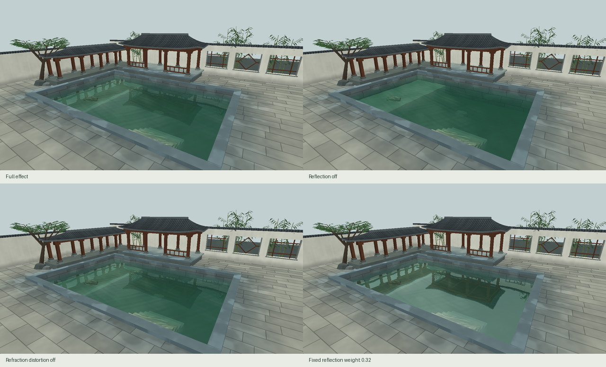
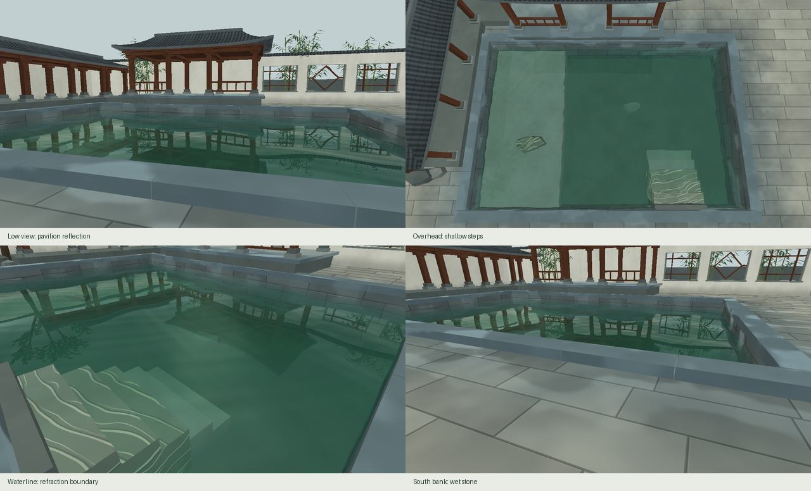

# 听雨小院 · 最终演示与复现

雨刚停，先从池南看水榭的檐口与柱影，再沿湿石铺地走向浅阶。俯视时可以循石脉辨认折射，降低视线后，漏窗与疏竹的倒影会变强。场景是参考网师园环池布局、拙政园临水建筑、沧浪亭复廊漏窗的融合设计。浅岸局部可见的池底纹样是课程演示折射的教学处理。

## 四帧技术对照



四帧均为 1280 × 720。相机位置 (6.6, 4.5, 8.5)，偏航 −32°、俯仰 −18.5°，波幅 0.35、主波方向 0、动画第 1 秒、吸收倍率 1。各图共享同一光源、场景和离屏尺寸。点开原帧可放大观察。

| 原帧 | 观察位置与含义 |
| --- | --- |
| [全效果](full.png) | 池后方保留柱影，前方仍可看到浅阶。 |
| [关闭倒影](no-reflection.png) | 反射权重归零，建筑倒影消失，透射与水面高光仍保留。 |
| [关闭折射扰动](no-distortion.png) | 放大南岸前三阶，浅色石脉回到未偏移的位置。波浪几何、深度吸收和倒影继续启用。 |
| [固定混合](fixed-blend.png) | 以 0.32 固定权重代替视角相关的 Fresnel，俯视时也会混入较多屋顶倒影。 |

另以[零吸收原帧](no-absorption.png)单独检验深水着色，并用[水中路径长度图](depth.png)定位浅阶、深池和池壁。默认场景中，长路径组的吸收颜色差大于短路径组。[水光调整参数、像素统计与阶段 B 对照](../stage-c/README.md)

## 四个补充视角



[南岸低机位](grazing.png)看柱影与窗格；[俯视](top.png)看深浅色差及折射参照；[近岸](edge.png)看台阶与池壁接缝；[南岸铺地](shore.png)看湿石与水线。四图与技术对照使用同一动画时刻。五个机位在 0、1、2 秒的 15 帧覆盖检查均未发现可见水面采到清屏深度；零振幅下，俯视机位开关折射扰动得到完全相同的 RGB 帧。

## 现场演示

1. 按[主 README](../../README.md#构建与运行)启动窗口。按 **F5** 回到全效果总览，并将相机、波幅、吸收和方向恢复为主题默认值，动画锁定在第 1 秒。
2. 依次按 **1**、**2**、**3** 对照倒影、折射扰动和 Fresnel。每看一项再按同键恢复。按 **4** 可循环检查反射、水下颜色与水中路径长度。
3. 反复按 **F6** 从总览依次切换到低机位、俯视、近岸、南岸铺地，再回总览。切机位保留动画时间与当前开关，适合现场单项比较。空格恢复动画，WASD 漫游。**R** 仅复位相机；**F5** 可随时重现报告首帧。

已在实际程序窗口通过定向键盘消息核对三个开关分别改变画面、再次按键恢复定帧原图，并核对 F5、F6、前移、复位、恢复动画及 Esc 退出。此项记录来自自动化窗口检查，组员人工评审另行记录。

## 指定演示机实测

2026-11-03，Windows 11 家庭中文版，Intel Core Ultra 5 125H、Intel Arc Graphics、驱动 32.0.101.8974，OpenGL 4.6。使用 CMake 4.4.4、MinGW-w64 GCC 15.2、GLFW 3.4、Release。主窗口、反射与折射目标均为 1280 × 720，全效果随时间更新。

| 最终构建 | 条件 | 帧数／时长 | 平均 FPS | 平均帧时间 | P95 帧时间 |
| --- | --- | --- | ---: | ---: | ---: |
| 可见窗口，第 1 次 | 交换间隔 1 | 600 帧／10.00 秒 | 60.00 | 16.67 ms | 17.24 ms |
| 可见窗口，第 2 次 | 交换间隔 1 | 600 帧／10.00 秒 | 60.00 | 16.67 ms | 17.32 ms |
| 隐藏窗口，吞吐测量 | 交换间隔 0，逐帧回读一个像素 | 300 帧／0.734 秒 | 408.77 | 2.45 ms | — |

**可见窗口达到 30 FPS 目标。** 两次正式测试都使用新构建目录中的最终程序。先预热 60 帧，再计时至少 10 秒；统计从事件处理、渲染到缓冲交换返回的墙钟时间。程序在尺寸变化、窗口最小化或提前关闭时判为无效。较早的开发构建在同机单次测得 99.82 FPS；表格依据最终构建的两次复测。

分项计时另用 60 帧，在每段末尾调用 glFinish，反射 **0.691 ms**、折射 **0.394 ms**、最终场景 **1.018 ms**。分项和可见窗口整帧使用不同的同步条件。

## 从空目录复现

在仓库根目录执行下列 PowerShell 命令。任选新的构建目录名。CMake 会使用本地 GLFW 或首次下载 GLFW 3.4；本次空目录复建显式复用了已缓存的 GLFW 3.4 源码。导出 PNG 的脚本需要 Python 3 与 Pillow 9.1 或更新版本，渲染程序本身无此依赖。

```powershell
cmake -S . -B build-demo -G "MinGW Makefiles" -DCMAKE_BUILD_TYPE=Release
cmake --build build-demo --parallel
.\build-demo\courtyard.exe --benchmark visible
.\build-demo\courtyard.exe --benchmark
python scripts/reproduce_demo.py build-demo/courtyard.exe build-demo/frames --verify docs/final
```

本次两套构建生成的 10 张原帧（四帧技术对照、两帧吸收诊断、四个补充视角）逐像素一致。`--verify` 在尺寸或任一 RGB 像素不同时返回失败。同机同驱动适用精确比对；换驱动时可省略该参数重新导出，再检查构图、水线与各单项差异。

## 设计与资产出处

| 来源 | 项目中的转译或使用 |
| --- | --- |
| [苏州市园林和绿化管理局 · 网师园](https://ylj.suzhou.gov.cn/szsylj/sjyc/201905/8aaf3adcfdaf485dada9a071aac3867f.shtml) | 紧凑的环池布局，保留中央开阔水面。 |
| [苏州市园林和绿化管理局 · 拙政园](https://ylj.suzhou.gov.cn/szsylj/sjyc/201905/c1df393edc8745abb20e8a9bd5525782.shtml) | 临水建筑的高低层次转译为水榭、低台和短廊。 |
| [苏州市园林和绿化管理局 · 沧浪亭](https://ylj.suzhou.gov.cn/szsylj/sjyc/201904/92cba6ca05a2451bb363c82895cc862e.shtml) | 取复廊和漏窗借景的手法，以贯通窗洞框住后方疏竹。 |
| [GPU Gems · Mark Finch](https://developer.nvidia.com/gpugems/gpugems/part-i-natural-effects/chapter-1-effective-water-simulation-physical-models) 与 [GPU Gems 2 · Tiago Sousa](https://developer.nvidia.com/gpugems/gpugems2/part-ii-shading-lighting-and-shadows/chapter-19-generic-refraction-simulation) | 技术参考分别用于多尺度波形与法线、屏幕空间折射与边界回退。 |
| [场景几何](../../src/scene.cpp)、[程序材质](../../src/material.cpp)、[水面与法线纹理](../../src/water.cpp) | 建筑、石阶、植物和纹理均由项目代码生成。全部 PNG 来自本程序实渲；没有采用外部照片或模型。 |
| [GLFW 3.4 许可证](https://github.com/glfw/glfw/blob/3.4/LICENSE.md) | 窗口与 OpenGL 上下文库，原作者 Marcus Geelnard、Camilla Löwy 等，按 zlib/libpng 许可证使用，依赖源码未修改。 |
