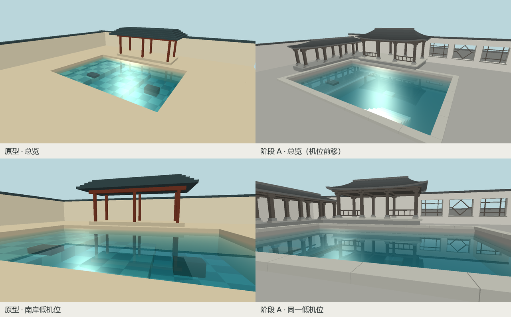
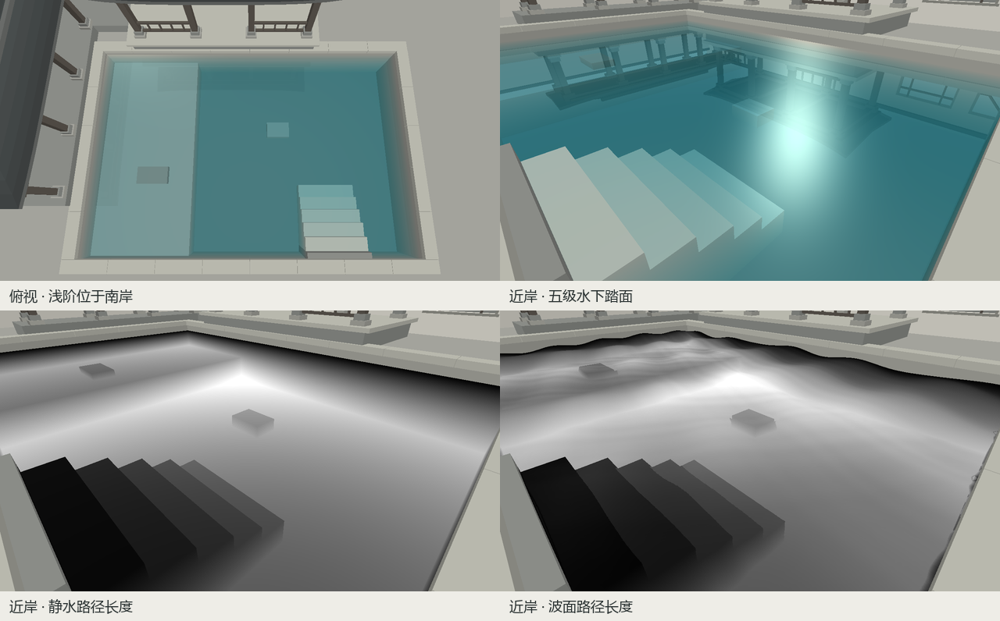

# 听雨小院 · A 阶段空间灰模

## 总览与低机位

左列为改造前，右列为阶段 A。四张图均在 1280 × 720、振幅 0、动画时间 1 秒下渲染。总览机位从 (8.2, 5.5, 10.4) 前移到 (6.6, 4.5, 8.5)，让池面与南岸台阶更靠近画面前景。两张低机位图采用完全相同的相机参数，可直接比较檐线、窗格与倒影。



- 北侧水榭以台基、柱础、栏杆、起翘檐口和瓦脊形成轮廓。西侧短廊较低，保留水榭中间开间和中央倒影区的视线。[全尺寸总览](overview.png)
- 北墙留出三个贯通窗洞，用直棂和菱形棂两种窗样组织节奏。两处机位均能透过棂条看到独立的后墙与天空；低机位还能辨认水中的菱形与柱影。[全尺寸低机位](grazing.png)
- 池面保持 12 × 8、平均水位 y = 0。分段压顶之下是连续的实体池壁。南岸设一道跨水线的平台，连接五级浅阶。场景几何由同一组函数供主场景、反射和水下通道使用，见 [scene.cpp](../../src/scene.cpp)。

## 近岸接缝

上排为俯视和近岸实景，下排是相同近岸机位的水中路径长度。越亮代表路径越长，超过 5 个场景单位显示为白色。静水图中，浅阶呈分级灰度，远侧池壁与水面相接处逐渐变暗。[全尺寸静水深度图](edge-depth.png)



首轮检查出现过一条沿岸亮线。波峰高于平均水位时，按 y = 0 裁剪会漏掉紧邻波峰的竖直壁面，视线可能命中后方更远的几何。折射通道现按当前振幅保留波峰可达高度内的池壁。以振幅 1、时间 1 秒复查 `edge`，取原图第 80–1099 列、每列从首个可见水面像素向下的 8 个像素，该区域的饱和白像素从 **1,452 降至 0**。

另用 `coverage` 模式检查空深度。它把原始采样或回退后的最终采样命中清屏深度的水面像素标成品红，有效命中标成绿色。四机位 × 三档振幅（0、1、2），共 12 帧，均未检出品红像素。该检查只识别空深度，命中错误距离需结合上面的路径长度图判断。

## 复现

从仓库根目录按 [README](../../README.md#构建与运行) 构建 Windows Release，在 PowerShell 执行：

```powershell
foreach ($view in 'default','grazing','top','edge') {
    .\build\courtyard.exe --capture "build/a-$view.ppm" 0 1 full $view
    foreach ($amp in 0,1,2) {
        .\build\courtyard.exe --capture "build/mask-$view-$amp.ppm" $amp 1 coverage $view
    }
}
foreach ($amp in 0,1) {
    .\build\courtyard.exe --capture "build/edge-depth-$amp.ppm" $amp 1 depth edge
}
```

本机 Intel Arc Graphics、驱动 32.0.101.8974，全分辨率离屏、1280 × 720 隐藏窗口基准测得 300 帧平均 **1.255 ms/帧**。阶段 A 沿用了原水面着色，静水总览中仍有较亮的高光；B 负责材质、浅岸纹样与植物，C 再联调水色及高光。
