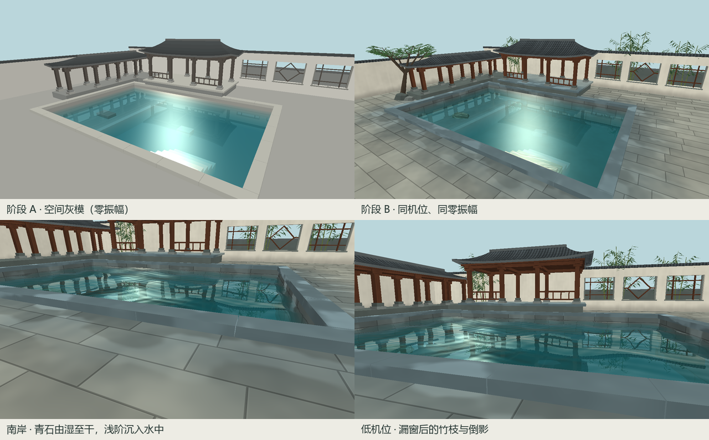
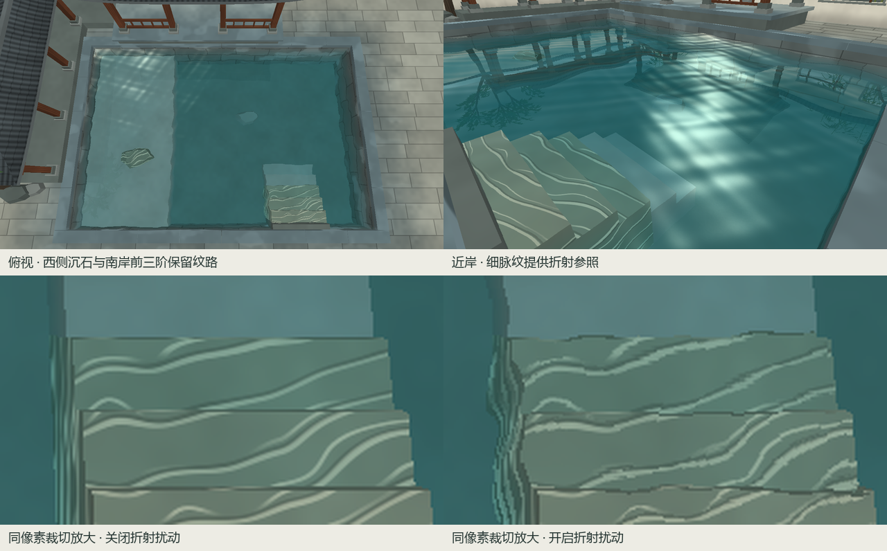

# 听雨小院 · B 阶段材质与近景



上排两图均为 1280 × 720、默认机位、零振幅、第 1 秒。屋面的顺坡瓦垄和叠瓦接缝勾出檐线，暖灰白粉墙在墙脚略暗，深木沿梁柱的长轴走纹。南岸铺地有错缝和石色变化，距池边约两米半以内逐渐压暗，少数低洼处随视角出现冷色亮部。[全尺寸总览](overview.png) · [全尺寸南岸近景](shore.png)

窗后和廊端的竹节、侧枝和尖叶使用固定种子生成。西侧斜枝树与岸石压住画面一角，池面中央继续留给建筑倒影。几何和表面纹理均由本项目源码生成，主场景与镜像共用同一份几何和材质。[场景几何](../../src/scene.cpp) · [程序材质](../../src/material.cpp)

## 浅岸折射参照

A 阶段已移除整池棋盘格。本阶段将石脉限定在南岸前三个水下踏面及西侧浅台的一块沉石，其余池底只保留低对比度的石面变化。



下排从同一俯视帧裁取相同的 208 × 117 区域（左上角 738, 507），仅切换折射扰动。振幅 0.45、第 1 秒时，开启扰动后可沿浅色细脉追踪局部偏移，原始裁切区有 17,015 个 RGB 像素变化。振幅归零后，两张完整俯视帧逐像素相同。截图用的 0.45 是验收参数，应用默认振幅仍为 1；总览中较亮的水面高光留待 C 阶段联调。

## 复现与回归

按仓库 [README](../../README.md#构建与运行) 构建 Release，在 PowerShell 运行：

```powershell
foreach ($view in 'default','shore','grazing','top','edge') {
    .\build\courtyard.exe --capture "build/b-$view.ppm" 0.45 1 full $view
}
.\build\courtyard.exe --capture build/b-flat.ppm 0 1 full default
.\build\courtyard.exe --capture build/b-top-off.ppm 0.45 1 no-distortion top
.\build\courtyard.exe --benchmark
```

- 在同一机器上独立启动两次，默认机位、同参数的全效果截图逐像素一致。
- 对 `default`、`grazing`、`top`、`edge` 运行 `coverage` 检查，振幅分别取 0、1、2，第 1 秒的 12 帧均有有效水面像素，空深度像素均为 0。
- 本机 Intel Arc Graphics（驱动 32.0.101.8974），Windows Release、全效果、1280 × 720 全尺寸离屏，隐藏窗口关闭垂直同步。预热 60 帧后测 300 帧，总计 0.880 秒，平均 **2.93 ms/帧**。演示机的可见窗口验收安排在 D 阶段。
