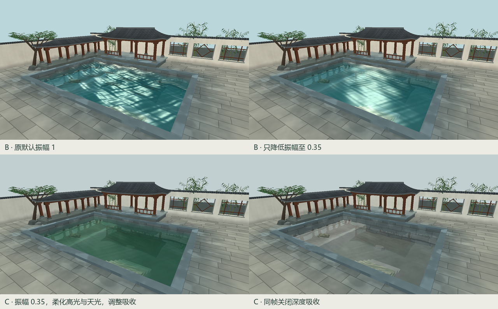

# C 阶段 · 水与光联调

总览固定在第 1 秒。左上保留阶段 B 的默认状态，右上只降低振幅。B 的旧高光在平缓水面上仍形成一整片白斑，因此 C 同时降低了高光峰值，用较宽的高光模拟云后天光。主视图和镜像视图使用同一世界方向的侧光。默认振幅为 0.35，几何波理论最大位移由 0.102 降为 0.0357 个场景单位。池水采用低饱和青绿色的透射底色，红光衰减最快、绿光最慢。

**高光复核。** 在 B、C 总览都属于水面的 146,621 个像素中，以显示 RGB 加权亮度（0–255）大于 210 计数，B 默认有 8,017 个高亮像素；B 仅降低波幅仍有 13,734 个；C 默认降至 0。岸边柱影在低机位保持连续，俯视仍能认出浅阶纹路。

**单项复核。** C 阶段各对照固定 1280 × 720、默认机位、振幅 0.35、动画时间 1 秒，相对全效果只改变一项。使用 coverage 掩模核实下列差异均出现在可见水面内。

| 对照项 | 仅改变的状态 | 变化的 RGB 像素 |
| --- | --- | ---: |
| 倒影 | 反射权重归零 | 146,858 |
| 折射 | 仅关闭纹理采样偏移 | 49,587 |
| Fresnel | 用固定权重 0.32 代替 Schlick | 146,383 |
| 深度吸收 | 三通道吸收强度归零 | 146,934 |

按水中路径长度图分组，关闭吸收后，短路径组（灰度 <51，约 1 个场景单位以内）的三通道平均绝对差为 9.30，长路径组（灰度 ≥153，约 3 个单位以上）为 35.22。折射、倒影及光照参数在该诊断中保持相同。
